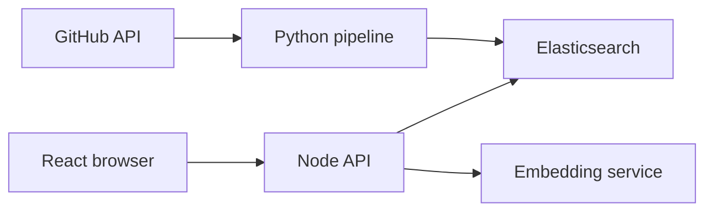
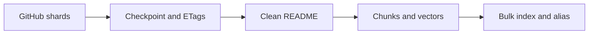
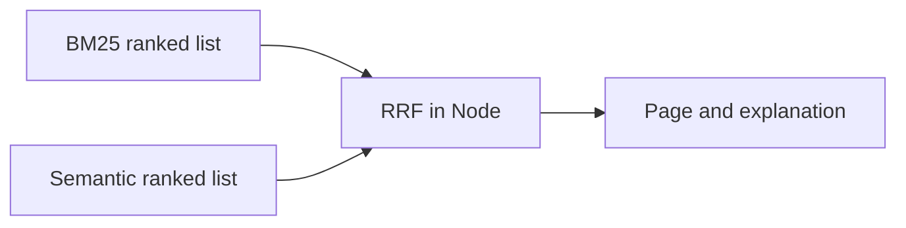
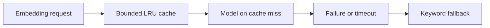
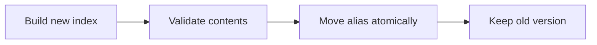

# Gitgrep: architecture from basics to advanced

A beginner's guide to how this project collects repositories, understands a query and returns results. Start with chapters 1-6, then follow the implementation and experiments. Diagrams show logical components, not necessarily separate machines.

This guide describes implemented behavior. The active local website at http://localhost:5174 uses balanced retrieval over 4,000 public repositories across eight languages. A separate 50-repo Python fixture remains for reproducible tests and evaluation. Scheduled refreshes and on-demand discovery remain future work.

Reading map: 1 - purpose; 2 - system diagram; 3 - collection; 4 - keyword search; 5 - vectors; 6 - balanced retrieval; 7 - rank fusion; 8 - filters and pages; 9 - reliability; 10 - storage and deployment; 11 - measurement; 12 - code walkthrough and next steps.

## 01. What problem are we solving?

Imagine searching for "tool for building chatbots". A relevant project may describe itself as a "conversational agent framework". Matching only identical words can miss it. Meaning-based search can help, but can also overlook an exact repository name. Gitgrep combines both signals.

A repository is a GitHub project. Metadata describes it: name, description, language, stars, topics and last push time. Its README explains what the project does and how to use it. We index this information; we do not search every source-code file.

An index is a prepared lookup structure, like the index at the back of a book. Preparing it costs work, but finding an entry becomes easier. Elasticsearch builds text and vector lookup structures for us.

Collection happens before searching. A GitHub token authenticates collection requests and increases the available quota. It does not create an unlimited local copy of GitHub. The API answers queries over repositories already indexed.

Try fastapi in the browser, then "tool for building chatbots". One query names a specific tool; the other describes an intention. Inspect http://localhost:5050/api/search?q=fastapi to see the JSON behind the interface.

## 02. The complete architecture

The frontend collects input and displays results. The Node API validates requests, coordinates retrieval and returns consistent JSON. Elasticsearch stores searchable documents. The Python embedding service converts query text into vectors.

The pipeline is a separate workflow. It fetches public repositories, prepares text, generates vectors and indexes documents. Query vectors and document vectors must use the same model and revision. Two different models may output 384 numbers without producing comparable coordinates.

The browser talks to Node. Node talks to ES and the model. Default development ports are frontend 5173, API 5050, embeddings 6001 and ES 9200. The active local frontend uses 5174 because another application occupies 5173. Containers use internal service hostnames between themselves. An existing frontend server can coexist with the Compose frontend on 5174; CORS must match the origin used in the browser.

Read backend/src/app.ts for routes, backend/src/search.ts for retrieval, services/embedding_service.py for model serving, scripts/ for ingestion and infra/ for Docker and operational checks. Docker Compose can put these components on one machine; the diagram does not require six servers.

## 03. From GitHub to searchable documents

GitHub Search caps returned results per query. The collector splits requests by language, stars and created-date range, subdividing large shards. Repository IDs remove duplicates. Only explicitly public records may enter its checkpoint or output.

A checkpoint saves completed work for resumption after interruption. An ETag is a server-provided version label used in conditional requests. Rate-limit headers tell us when to wait; backoff increases the waiting time after repeated temporary failures. An unsplittable single-day/single-star shard fails instead of silently dropping results.

README downloads are capped. Images, badges, HTML noise and table-of-contents links are cleaned. Headings supply passage context. Long sections split into windows of 220 model tokens, with 32-token overlap. A token is a model-recognized text piece, not necessarily a word. Overlap helps preserve ideas crossing chunk boundaries.

A content hash identifies unchanged text. SQLite caches embeddings by text/model identity. Bulk indexing sends batches of documents. For much larger collections, whole-JSON checkpoint rewriting and full-file indexing should become incremental/streamed. The live collector has completed 4,000 repos across eight languages. Downloads use eight paced workers, and checkpoints flush every 20 new repos plus page boundaries. Interrupted work may replay a small cached remainder.

## 04. Keyword search and BM25

An inverted index maps a term to documents containing it. Elasticsearch can look up "chatbot" candidates without reading every README from beginning to end.

An analyzer transforms text into searchable terms. Lowercasing helps Python match python. The name analyzer splits separators and camelCase so fast-api and fastAPI share useful terms. An edge-ngram subfield supports partial names. Language and topics use exact-value fields for filtering rather than the same analysis as free text.

BM25 ranks matching documents using term frequency, rarity across the collection and document length. A rare matching term can be more informative than a common one. We boost names and descriptions because these often state a project's purpose directly.

BM25 handles names and specific vocabulary well. It does not inherently know that "conversational agent" and "chatbot" may mean similar things. Fuzzy name matching helps some typos, but is different from semantic matching.

keywordRequest() builds this retrieval. A nested README query selects its best chunk. Both text and semantic retrieval share a filter builder, so language, stars, topics, quoted phrases and exclusions constrain both paths.

## 05. Embeddings, cosine and HNSW

An embedding is an ordered list of numbers representing text. MiniLM produces 384 coordinates. They are learned features; coordinate 17 does not have a dependable label like "Python usefulness".

Related text tends to produce vectors pointing in related directions. We normalize vectors to unit length. Cosine measures directional agreement; for normalized vectors, cosine is their dot product. It is a similarity signal, not a probability of relevance.

Exact search compares eligible vectors directly. Approximate nearest-neighbor search tries to find good neighbors with less work, accepting that it can miss some. HNSW connects vectors in a navigable graph. This search structure differs from a graph database containing relationships such as "repository depends on package".

HNSW m=16 controls connectivity and ef_construction=100 controls construction effort. Query candidate counts trade work for recall. These are explicit baseline choices, not measured universal optima.

Quantization compresses representations. Float32 uses four bytes per coordinate; int8 uses one for its compressed copy. ES also retains original vectors, so fourfold compression of that copy is not fourfold total RAM or disk savings. Compression can change candidate selection and must be evaluated for relevance.

## 06. The balanced search experiment

The active balanced index uses one int8 HNSW summary vector per repo. The summary combines name, description, topics and README introduction. The first stage shortlists REPO_CANDIDATES repos, default 200, with enough candidates retained for the configured pagination depth.

The second stage compares the query with passages only in shortlisted repos. Passages use a flat vector format with no passage HNSW graph. Exact cosine scoring selects the best passage for each repo. Both stages enforce the same constraints. Full passage vectors still exist on disk; fewer graph-indexed vectors is not a measured total-memory saving.

The tradeoff is important: two sequential ES calls add overhead, and exact scoring grows with shortlisted repos, passage counts and dimensions. A repo missed by its summary cannot be recovered even if a later README passage would be perfect.

Our fixture contains only 50 repos, fewer than the default shortlist. Equal relevance here therefore does not establish shortlist recall at scale. The fixture comparison kept chunk search as its default. The larger website now explicitly selects SEARCH_STRATEGY=balanced against gitgrep-live. Read docs/BALANCED.md for fixture results and docs/LIVE.md for active-corpus checks and measurements.

## 07. Rank fusion and explanations

BM25 and vector scores have different scales. Direct addition depends on a weight that may not transfer between queries. Reciprocal Rank Fusion (RRF) uses positions instead. Each list contributes 1 / (60 + rank), with ranks starting at 1. Absence from a list means zero contribution from that list.

For example, repo A is keyword rank 1 only: 1/61 is about 0.01639. Repo B is rank 2 in both lists: 2/62 is about 0.03226. Agreement wins even though A led one list. This can bury a strong exact match; eval/RESULTS.md records five losing cases.

Node performs fusion without relying on ES's licensed RRF retriever. Stable repository IDs break ties. The explain payload reports keywordRank, semanticRank, fusedScore and cosine. Fused score is an ordering signal, not confidence. In balanced retrieval, cosine describes the exact best passage after shortlisting.

BM25 starts while query embedding runs. Semantic retrieval waits for the vector. This parallelism overlaps independent work, but cannot remove the dependency between summary shortlisting and passage scoring.

## 08. Filters, passages and bounded pages

Operators include lang:rust, stars:>500, topic:cli, quoted phrases and -excluded terms. The hand-written tokenizer scans left to right. Unknown or empty operators remain searchable text. Explicit URL parameters override operators on conflict.

A prefilter constrains eligibility before selecting nearest neighbors. Filtering only afterward could remove most selected candidates and leave too few results. Balanced retrieval filters its summary search and rechecks constraints while scoring passages.

The response contains plain passage text up to 400 JavaScript code units. Highlight pairs are start-inclusive/end-exclusive offsets into that returned string. JavaScript uses UTF-16, so an emoji can use two code units. The UI must render text safely rather than interpreting untrusted README text as HTML.

MAX_DEPTH defaults to 100. Fusion operates on bounded lists and then slices a page. A lookahead helps detect truncation. The total describes this bounded pool, not every potentially relevant document. Concurrent updates can move results between pages.

/api/compare returns separate and fused top-ten lists. /api/similar/:id seeds retrieval from a repo vector and excludes itself. /api/facets returns cached language/topic counts. The balanced experiment preserves the same public request/response contract.

## 09. Caches, failures and observability

The bounded LRU cache keeps recently used query embeddings and evicts older ones. Concurrent identical misses share one in-flight computation. Facet counts use a separate time-to-live cache. Caching avoids repeated work; it does not remove the cost of every new query.

The model loads once at startup. Bounded batch requests and serialized encoding avoid uncontrolled model concurrency. The Linux image uses CPU Torch. Supported host installs may use available accelerators.

Outbound calls have timeouts. Embedding failure returns keyword results with degraded=true and a reason. A circuit breaker pauses calls after repeated failures, then allows one recovery probe. ES failure cannot be solved by keyword fallback because keyword search also needs ES.

Liveness checks the API process. Readiness checks dependencies. A process may be alive while full search is unavailable. Request IDs connect logs with responses; Server-Timing separates stages; Prometheus metrics count requests, latency, cache behavior and failures.

CORS restricts allowed browser origins. Helmet sets HTTP security headers. Rate limiting bounds requests per IP. Centralized errors hide stack traces and upstream details. Graceful shutdown drains active requests before terminating.

## 10. Storage, aliases and deployment

A repo document stores metadata and nested passages. Nested storage preserves the association between each passage's heading, body and vector. It avoids application-side joins, but a repo update can rewrite its nested block.

A versioned index sits behind an alias such as gitgrep. The indexer writes and refreshes a new version, then moves the alias after successful bulk operations. Incremental writes to one version do not remove repos absent from later input. Use fresh versions for replacement snapshots. A layout mismatch is rejected before writes.

Compose runs four services with healthchecks, persistent volumes and memory limits. A volume survives container replacement. Development ES authentication is explicitly disabled on loopback. Production enables authentication, keeps ES/model ports private and supplies a read-only backend API key. A host reverse proxy provides TLS.

More machines add capacity and operating cost. Multiple API processes also need coordinated rate limiting and cache decisions. A graph database can support future dependency traversal; it is not required for the present search path. Disk indexes, operating-system page cache and application heap are different memory/storage layers.

## 11. Testing and interpreting measurements

Unit tests check small functions. API tests exercise HTTP behavior with controlled upstreams. Integration tests use real ES/model services and compare filtered IDs/counts to exhaustive fixture predicates. make test runs isolated tests; make integration checks the original search; make balanced-seed balanced-check runs the alternative and comparison.

Relevance grades are 0, 1 and 2. nDCG@10 rewards strongly relevant results near the top. MRR@10 measures how early the first relevant result appears. Recall@10 counts nominated relevant repos found in the top ten. Labels are assistant-authored and need owner review. Unlisted repos count as zero; false zeros affect conclusions.

p95 latency means 95% of measured requests finished at or below that time. Throughput counts requests per second under stated load. A sequential warmed comparison is not a concurrent load test. A cold embedding cache differs from a cold model or filesystem cache.

The balanced experiment measures 50 queries in three alternating rounds: 150 requests per strategy. It also measures one 50-query cold embedding-cache pass per strategy and records index bytes and query timing. It does not attribute RAM consumption to either index, and it cannot establish behavior at millions of repositories. Read eval/balanced-results.json and docs/BALANCED.md before repeating any performance claim.

## 12. Trace a request and plan the next step

1. The browser calls GET /api/search?q=chatbot&mode=hybrid. app.ts applies headers, limits and validation; query.ts extracts text and constraints.

2. search.ts starts keyword retrieval. upstreams.ts checks its query-vector cache and calls /embed on a miss.

3. Chunk mode searches nested passage HNSW. Balanced mode searches summary vectors, then scores shortlisted passages. fusion.ts merges lists and creates passage highlights.

4. The API slices the page and returns JSON, timing headers and a request ID. Logs and metrics record operational behavior.

Learn by comparing modes for the same query, then adding a language filter. Use make outage-check to observe fallback and recovery; it briefly stops and then restores the embedding container.

The 4,000-repo corpus now exceeds the default 200-repo shortlist. Next, review larger-corpus labels, vary the candidate budget and run mixed-query concurrent tests. Measure actual RAM, page cache, disk, relevance and cold/warm latency. Scheduled refreshes and asynchronous GitHub discovery remain future work. Complete GitHub coverage is not claimed.

Further reading: docs/API.md, docs/DESIGN.md, docs/DEPLOY.md, docs/BALANCED.md and eval/README.md. Primary references: https://www.elastic.co/docs/deploy-manage/production-guidance/optimize-performance/approximate-knn-search and https://docs.github.com/en/rest/search/search.
