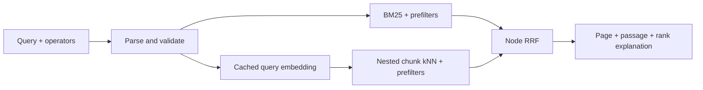

# gitgrep

**Search GitHub repositories by name, intent and README passage.**

Gitgrep combines BM25 keyword retrieval with MiniLM semantic search, then merges the two ranked lists using Reciprocal Rank Fusion in Node. Results include the matching passage, relative highlight offsets and an explanation of each retriever's rank.

[Beginner architecture guide](ARCHITECTURE.md) · [Illustrated PDF](Gitgrep-Architecture.pdf) · [Quickstart](#quickstart) · [API](docs/API.md) · [Design](docs/DESIGN.md) · [Documentation](docs/README.md) · [Contributing](CONTRIBUTING.md)

The search has also been run locally on a larger corpus of **4,000 public repositories across eight languages**, using balanced retrieval ([dataset, setup and verification](docs/LIVE.md)). A checked-in **50-repo Python fixture** is kept separate for reproducible tests and relevance evaluation. All quality numbers below refer to that fixture and use provisional relevance labels.

## Quickstart

Prerequisites: Git, Node 22+, uv, and Docker with Compose v2. Allow about 6 GiB of Docker memory and network/disk capacity for the initial image and model downloads. The embedding image contains the pinned model and runs offline after building.

```sh
git clone https://github.com/sasmith-14/gitgrep.git
cd gitgrep
make install
make up
make seed
make verify
```

This seeds the 50-repo fixture and opens the website at [localhost:5173](http://localhost:5173). To build the larger 4,000-repo corpus, follow [LIVE.md](docs/LIVE.md). Try the API directly:

```sh
curl -fsS --get http://localhost:5050/api/search \
  --data-urlencode 'q=lang:python tool for building chatbots' \
  --data 'mode=hybrid&size=3'
```

`make up` starts Elasticsearch, embeddings, the API and the frontend with healthchecks. `make seed` reuses unchanged vectors/documents. `make down` stops the stack and keeps its data volumes. Run `make help` for the command list; see [development](docs/DEVELOPMENT.md) for configuration, host processes and occupied ports.

## How search works



BM25 starts while the query embedding is fetched. Both retrievals apply the same filters before selecting candidates. RRF uses ranks instead of adding scores with incompatible scales. It can still lose a strong result found by just one retriever; the evaluation records five such cases.

The pipeline fetches public repository metadata and READMEs, cleans/chunks text by heading, embeds batches and writes content-hashed documents behind a versioned ES alias. Normalized 384-dimensional vectors use cosine/HNSW. The [design notes](docs/DESIGN.md) explain nested chunks, analyzer choices, bounded pagination and rejected alternatives.

| Capability | Implementation | Check |
|---|---|---|
| Retrieval | Keyword, semantic and hybrid modes; RRF k=60; shared prefilters | `make integration` |
| API | Operators, explicit overrides, pagination, compare, similar and cached facets | `make smoke` |
| Failure handling | Embedding timeout, circuit breaker and explicit keyword fallback | `make outage-check` |
| Observability | Request IDs, stage timings, structured logs and Prometheus | `make smoke` |
| Pipeline | Adaptive shards, checkpoints/ETags, normalized batch cache and idempotent bulk writes | `make test seed` |
| Production ES | Authentication and a read-only API key | `make prod-check` |

The [API contract](docs/API.md) includes curl examples and captured responses. `/search` remains a compatibility route for the existing frontend. Deep paging is capped at 100 candidates by default; totals describe the bounded retrieval pool.

## Balanced retrieval

Balanced retrieval shortlists repository summary vectors with int8 HNSW, then scores flat passage vectors only within those repositories. It is enabled on the larger local website through `gitgrep-live`. The separate 50-repo fixture still uses chunk search; `make balanced-seed balanced-check` reproduces its [comparison](docs/BALANCED.md). See the [live benchmark](eval/LIVE-BENCHMARK.md) for measured latency on 4,000 repos. No complete GitHub coverage or total-RAM reduction is claimed.

## Live corpus measurements

Recorded 2026-11-04T07:12:36.718Z on Apple M5 with 16 GiB host RAM: **4,000 repositories, 96,045 passages**, balanced retrieval. Each scenario is a 10-second single-query run; these are not larger-corpus relevance scores or a production capacity forecast.

| Cache | Connections | p50 ms | p95 ms | p99 ms | req/s |
|---|---:|---:|---:|---:|---:|
| cold embeddings | 1 | 43.79 | 51.41 | 59.68 | 22.43 |
| cached embeddings | 1 | 37.60 | 44.86 | 47.78 | 26.07 |
| cached embeddings | 8 | 180.79 | 236.67 | 258.22 | 43.04 |

Reproduce: `make live-bench`. [Full conditions and raw counters](eval/LIVE-BENCHMARK.md).

## Fixture retrieval quality

**50 queries, 50 repositories, provisional labels.** Queries cover exact names, intent, synonyms, acronyms and typos. Unlisted repositories count as zero relevance; these judgments are a regression fixture, not human ground truth or a held-out benchmark. Follow the [label-review instructions](eval/README.md) before presenting quality claims.

<!-- eval:start -->
Recorded 2026-11-04T07:14:25.639Z; 50 queries / 50 repos, provisional labels.

| Mode | nDCG@10 | MRR@10 | Recall@10 |
|---|---:|---:|---:|
| keyword | 0.7784 | 0.8381 | 0.7917 |
| semantic | 0.8034 | 0.8407 | 0.9067 |
| hybrid-RRF | 0.8239 | 0.8683 | 0.8967 |
| weighted-score | 0.8084 | 0.8547 | 0.8717 |
<!-- eval:end -->

Reproduce with `make eval`. [Full results](eval/RESULTS.md) include five failures and [per-query rankings](eval/fixture-run.json). The naive baseline adds 0.5×BM25 + 0.5×ES vector score without tuning. `make eval-check` checks dataset/model identity and rejects an absolute nDCG drop greater than 0.05. Optional reranking and alternative-model experiments are unrun.

## Measured local latency

<!-- bench:start -->
Recorded 2026-11-04T04:13:40.070Z; Apple M5, 16.0 GiB host RAM, 50 repos. Full conditions in the benchmark report.

| Query cache | Connections | p50 ms | p95 ms | p99 ms | req/s |
|---|---:|---:|---:|---:|---:|
| cold embeddings | 1 | 21.35 | 30.98 | 49.03 | 44.51 |
| cached embeddings | 1 | 11.80 | 14.80 | 15.91 | 82.53 |
| cached embeddings | 8 | 32.91 | 48.18 | 61.53 | 233.63 |
<!-- bench:end -->

Reproduce with `make bench`. Each row is a 10-second, single-query test against real ES/model services. “Cold” means a query-embedding cache miss after model warmup; ES caches are not cleared. Rate limits are raised only in the harness. These results are not a production capacity forecast. [Full conditions and raw counters](eval/BENCHMARK.md) include machine, model, index size and error counts.

Evaluation and benchmarking use a recorded 10-second embedding timeout and reject degraded runs. The public API defaults to 800 ms and falls back to keyword retrieval when embeddings are unavailable.

## Repository guide

| Directory | Responsibility |
|---|---|
| [backend/](backend/) | TypeScript API, retrieval, fusion and Node tests |
| [services/](services/) | FastAPI model service and Python settings |
| [scripts/](scripts/) | GitHub collection, README chunking, embedding and indexing |
| [tests/](tests/) | Python tests and shared repository fixture |
| [eval/](eval/) | Query labels, runners, regression baseline and measured artifacts |
| [infra/](infra/) | Dockerfiles, nginx and operational checks |
| [frontend/](frontend/) | React client, maintained separately |
| [docs/](docs/README.md) | API, design, development, deployment and execution evidence |

`make verify` runs lint, unit/property/API tests, actual ES/model integration, endpoint smoke and the evaluation gate. [Recorded verification](docs/evidence/verification.txt) contains the outcomes; [GitHub Actions](https://github.com/sasmith-14/gitgrep/actions) defines CI checks and image builds. See [CONTRIBUTING.md](CONTRIBUTING.md) for change and baseline review, and [DEPLOY.md](docs/DEPLOY.md) for the single-VM configuration. No public deployment is claimed.

## Limits and next steps

- Review relevance labels and build a relevance set for the larger corpus. Collection and live activation commands are in [LIVE.md](docs/LIVE.md); keep larger-corpus quality claims separate from fixture metrics.
- Evaluate optional reranking and an alternate embedding model after label review. CUDA has not been validated; the Linux image uses CPU Torch.
- Complete frontend API migration and dependency updates before remote browser deployment. Provision VM/DNS/TLS and confirm remote CI results; local checks do not substitute for those steps.

## License

[MIT](LICENSE) © 2026 Sasmith A Suvarna. Third-party files are listed in [THIRD_PARTY_NOTICES.md](THIRD_PARTY_NOTICES.md).
